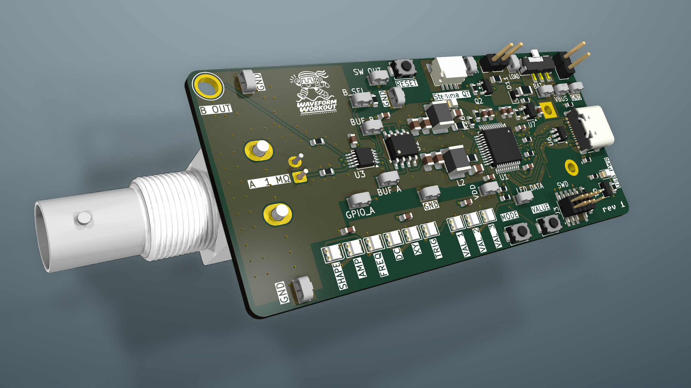

# Waveform-Workout

An open-source tool to test oscilloscopes for basic operation.

## Status

r1 is at the fab.

## Firmware

[Build and flash the trainer](firmware/README.md). On reset, both outputs target a 1 kHz sine at 1.00 Vpp centered on +0.75 V. Use MODE and VALUE to select waveform, DC, XY and trigger exercises.

## Design files

- [Schematic PDF](kicad/Waveform%20Workout%20Schematic.pdf)
- [PCB PDF](kicad/Waveform%20Workout%20PCB.pdf)
- [Open the project in KiCanvas](https://kicanvas.org/?repo=https%3A%2F%2Fgithub.com%2Fbaldengineer%2FWaveform-Workout%2Ftree%2Fmain%2Fkicad)
