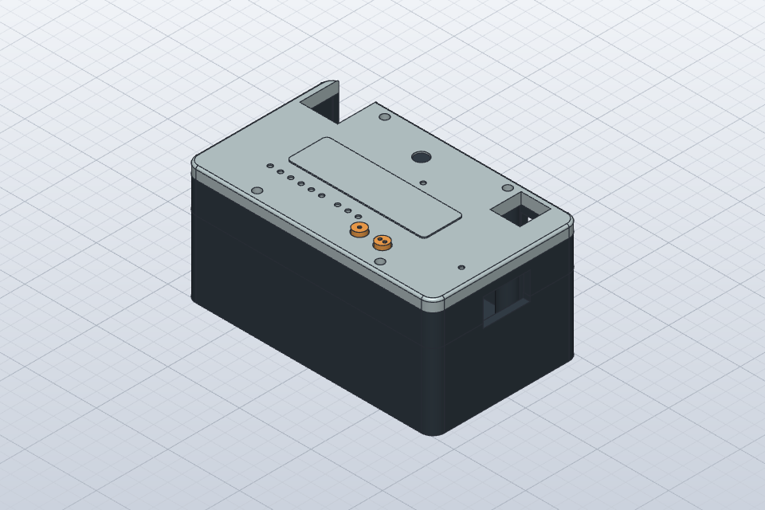

# Waveform Workout Rev 1 enclosure

The enclosure fits the 81.77 × 37.50 mm Rev 1 PCB with its back-mounted Keystone 1290-79 holder and 9 V PP3. The tray supports the board edges. The connector frame captures the PCB and lifts off for battery changes. With the lid fitted, the BNC, USB-C, STEMMA QT, power selector, and output B and ground clip points remain accessible.

- [Editable SolidCraft assembly](Waveform%20Workout%20R1.sc)
- [Six-part print plate](Waveform%20Workout%20R1%20-%20print%20plate.3mf)

## USB-only version

For a USB-powered build, omit the PP3 cell and Keystone BT1 holder and set the power selector to USB. The shallow tray takes the original lid, connector frame, three plungers, light guides and four M2.5 × 20 mm screws. If you already printed the PP3 enclosure, print just the USB tray and transfer the other parts. Use the print settings and tap dimensions below.

The USB-only enclosure measures **86.8 × 51.6 × 32.8 mm** over the raised buttons, 9.8 mm shorter than the PP3 enclosure. The rear BNC has 1.36 mm of modeled clearance above the floor. All 156 solids in the populated PCB export with BT1 omitted clear the enclosure. A CAD comparison confirmed that all five upper parts have the same geometry in both versions. Physical fit is untested.

- [USB tray only](usb-only/USB%20tray.3mf)
- [Complete USB-only print plate](usb-only/Waveform%20Workout%20R1%20-%20USB%20print%20plate.3mf)
- [Editable USB-only SolidCraft assembly](usb-only/Waveform%20Workout%20R1%20-%20USB.sc)

## Print and hardware

Use a 0.4 mm nozzle and 0.20 mm layers. Four perimeters are a starting point for the screw pillars. The 3MF places all six pieces on the bed in a 144 × 109 mm footprint. The tray prints floor-down, the connector frame lid-side down, and the lid sticker-side up. The plungers stand on their switch-contact ends. Add a small brim to the three plungers if bed adhesion is marginal.

The assembled PP3 version measures 86.8 × 51.6 × 42.6 mm over the raised buttons. Allow additional space for the BNC and screw heads on both versions. The raised sticker land is 48 × 14 mm with rounded corners. A 46 × 12 mm sticker leaves a 1 mm border for the light and button legend.

| Supply | Quantity | Fit |
| --- | --- | --- |
| M2.5 × 20 mm pan-head machine screws | 4 | Tap the tray's four 2.05 mm pilot holes M2.5 × 0.45 to at least 6 mm of usable thread. The pilots are 8 mm deep. |
| 2.00 mm clear filament | 9 pieces | Start at 11.4 mm long for the D1–D9 settings row. |
| 2.00 mm clear filament | 2 pieces | Start at 11.2 mm long for USB power (D10) and the diagnostic LED (D12). |

## Fit and assembly

1. Square and polish both ends of each light guide. From inside the lid, insert each piece into its 2.20 mm socket until it reaches the shoulder beneath the 1.60 mm light exit. Dry-fit the lid. The lengths above leave about 0.5 mm of air over the modeled LEDs. Trim to suit the assembled board, then secure each guide with a small dab of clear adhesive at the lid end. Keep the optical faces clean.
2. With USB and the battery disconnected, lower the PCB onto the tray ledges, holder down, with the BNC barrel in the open saddle. Fit the connector frame over the board. Check that the PCB sits flat and the frame seats against the tray without pressure on a component.
3. Insert the three plungers from inside the lid. MODE has one dimple, VALUE has two, and RESET has a shorter, recessed head. A strip of removable tape across the outer face can hold them during assembly. Fit the lid and tighten the four screws by hand. Remove the tape and check that each button moves freely, clicks, and releases.
4. For a battery change, disconnect USB, remove the screws, lift off the lid and frame, and lift the PCB by its edges. The BNC lifts straight out of its saddle. Keep the loose plungers with the lid.

## Fit checks

SolidCraft produced six closed bodies. The guide and plunger axes match the Rev 1 placement export. A solid-intersection check against the 173 solids in the populated KiCad STEP export found no overlap above 0.001 mm³. A 53 × 31 × 21.5 mm clearance envelope beneath the PCB also cleared all six printed parts. Each of the six exported print meshes is watertight.

Physical fit is untested. On the first print, check that the buttons release with the lid screwed down, that adjacent indicators remain distinguishable, and that your USB overmold, BNC coupler, and output B probe clip fit together. The SolidCraft parameters `socketDia` and `runningGap` adjust the light-guide and plunger fits for your printer.
