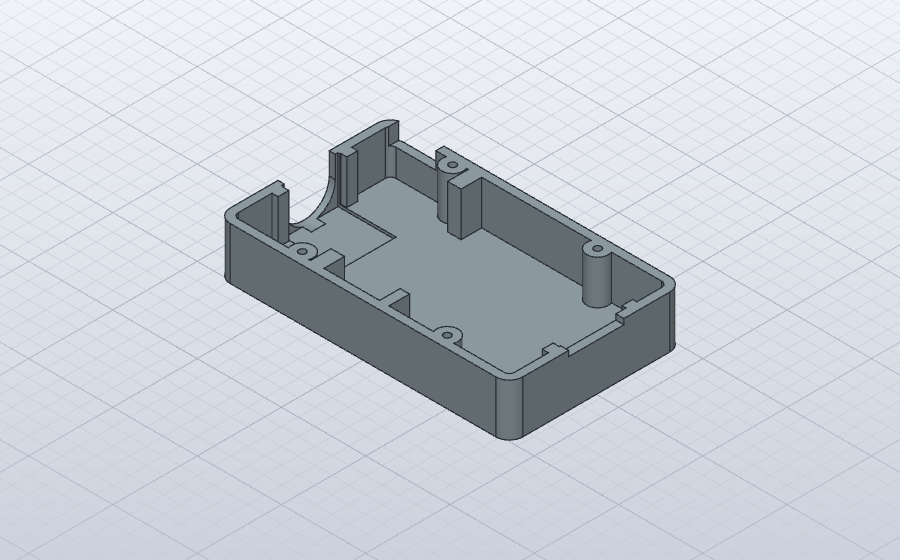

# Low-profile USB tray for the flush OLED lid

Use this variant with **J5** (SMU battery input), **JP1** (current-measurement link header), and the **BT1** battery holder omitted. Keep the J3 SWD header, rear BNC and USB-C connector. JP1 normally completes the regulator input path. With the header removed, maintain that path with a low-profile wire link across its pads for normal operation, or the intended R4 measurement shunt for a shunt-equipped build.

- [Print the conversion kit](Low-profile%20tray%20kit.3mf) — lower tray, connector frame and three shortened plungers.
- [Print the lower tray alone](Low-profile%20lower%20tray.3mf).
- [Editable SolidCraft assembly](Waveform%20Workout%20R1%20-%20low-profile.sc).

## What changes

The two-pin headers reach 10.14 mm above the underside of the trainer PCB. With both removed, the next highest pins belong to J3 at 7.57 mm. The connector frame is 8.4 mm tall, leaving 0.83 mm above those pins. The lower tray is 15.4 mm tall. A local recess beneath the BNC retains a 1.6 mm printed floor and provides 0.96 mm of vertical clearance. The closest BNC-to-tray clearance is 0.83 mm at the end wall.

With the [existing flush OLED lid](../oled/README.md), the assembled enclosure measures **86.8 × 51.6 × 29.2 mm** over MODE and VALUE. The shorter frame saves 2.4 mm and the revised lower tray saves another 1.2 mm compared with the original USB-only version.

## Assembly

1. Print the five-part conversion kit with a 0.4 mm nozzle and 0.20 mm layers. The supplied plate orients the tray floor-down, the frame lid-side down and the offset RESET finger pad down. Use a brim or local support on the small plungers as needed.
2. Tap the four tray pilots M2.5 × 0.45 to at least 6 mm of usable thread. Use **four M2.5 × 18 mm** pan-head case screws. They engage approximately 5.6 mm of the 8 mm pilots.
3. Fit the PCB and frame. Reuse the flush OLED lid, display and its mounting hardware. Install the three plungers from this kit. The offset RESET foot faces the center of the lid.
4. Shorten the light guides by **2.4 mm** from their fitted lengths, or start with **9.0 mm** for the nine settings LEDs and **8.8 mm** for D10 and D12. Dry-fit the lid and check for about 0.5 mm above the LED packages before securing the guides.

CAD checks used the 154 solids in the populated board export with BT1, J5 and JP1 omitted. The parts clear the board, the OLED fastening nuts and the module-side cable plug envelope. The lid has the same solid geometry as the standard flush OLED lid. Both print files contain watertight meshes. Physical fit is untested.
