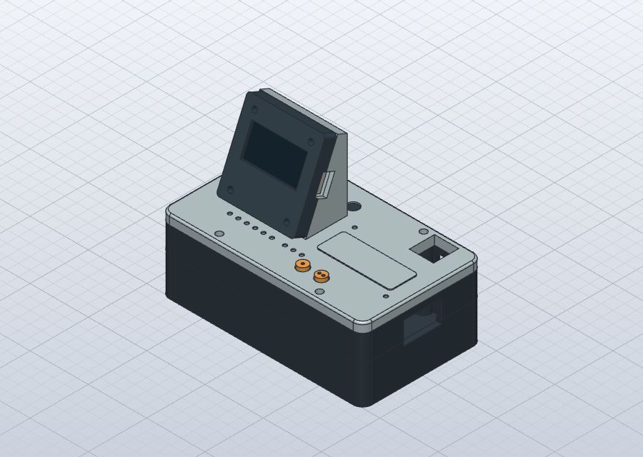

# Adafruit 128×64 OLED lid

This replacement lid fits the Rev 1 PP3 and USB-only trays. It holds **Adafruit product 326, the 0.96-inch 128×64 monochrome OLED with two STEMMA QT sockets**. The face tilts 67° from the lid toward the buttons. The bezel protects the glass edges and comes off from above. The 32 × 12 mm raised land beside it takes a 30 × 10 mm sticker. [Adafruit module](https://www.adafruit.com/product/326) · [STEMMA QT board drawing](https://github.com/adafruit/Adafruit-128x64-Monochrome-OLED-PCB/blob/51ef8e242dcf460d5effc298d8565110624e6b23/Adafruit%200.96in%20128x64%20OLED%20STEMMA%20QT.brd)

- [Print the lid and bezel](OLED%20lid%20and%20bezel.3mf)
- [Edit the SolidCraft assembly](Waveform%20Workout%20R1%20-%20Adafruit%20326.sc)

## Print and assemble

1. Use a 0.4 mm nozzle, 0.20 mm layers and four perimeters. The print plate places the lid underside down and the bezel face down. The CAD assembly also shows the USB tray, shared controls and reference electronics.
2. Tap the four 1.6 mm pilots in the inclined saddle M2 × 0.4. Use **four M2 × 10 mm pan-head screws** for the bezel. They engage about 4.4 mm of the saddle. Retain the existing M2.5 screws for the case.
3. Place the bare module glass-up in the saddle, with the eight-hole header row at the high edge. Use the board with its optional pin strip uninstalled. Fit the bezel over the glass and tighten the four screws evenly by hand. The bezel clamps the PCB at its mounting holes.
4. Transfer the three printed plungers and eleven light guides using the [original assembly instructions](../README.md#fit-and-assembly). Their lengths and fits are the same. The USB-only assembly reaches 65.9 mm high over the bezel, and the PP3 version reaches 75.7 mm.
5. With power disconnected, plug a four-conductor STEMMA QT cable into the OLED through the right-side opening. Route a short external loop to the trainer's J6 port, clear of the selector and probe opening. Display operation requires firmware that powers J6 and drives the OLED over I²C.

## Adjusting the fit

In SolidCraft, the module's local X and Y datum is the lower-left corner of its 29.21 × 31.75 mm bounding rectangle, viewed from the glass side with the header row up. The screen and mounting pattern have independent centers.

| Parameters | Default (mm) | Effect |
| --- | --- | --- |
| `holePitchX`, `holePitchY` | 24.13, 26.67 | Horizontal and vertical spacing of the four screws |
| `holeCenterX`, `holeCenterY` | 14.605, 15.875 | Moves the saddle pads, pilots, bezel collars and screw holes together |
| `mountBore`, `mountPilot` | 2.30, 1.60 | Bezel clearance diameter and saddle tap-drill diameter |
| `windowW`, `windowH` | 24.00, 13.00 | Clear opening over the 21.744 × 10.864 mm active area |
| `windowX`, `windowY` | 14.605, 19.401 | Center of the viewing opening |

The bodies named **Reference** show the Adafruit PCB, glass and connector envelopes. They retain their nominal dimensions when the mount parameters change. The 3MF contains just the two printable parts.

## Verification

Both print meshes are watertight. CAD checks found no solid overlap among the enclosure parts and reference module, or between the replacement parts and the 173 solids in the trainer PCB export. The bezel clears a straight-on projection of the full active area. The cable entry clears a 7.0 × 3.2 mm plug envelope over a 16 mm straight approach. Physical module fit, cable strain relief and screw engagement still need a first print.
