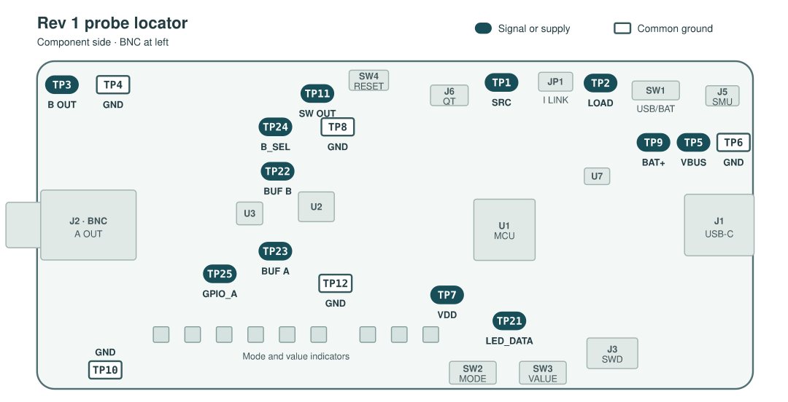

# Waveform Workout Rev 1 board test plan

Bring up one board on a current-limited supply before connecting a battery or a computer. Use that board to qualify the trainer exercises, then use the shorter screen at the end for the rest of the lot. Record measurements against each board ID.

This plan follows the **rev 1** silkscreen, the local production pad netlist and the assembly BOM at hardware commit `0b94bae`. The power sources are USB-C and a 9 V alkaline PP3. Confirm substitutions and assembly exclusions against the order paperwork when the boards arrive. [Assembly BOM](production/bom.csv) · [Sourcing and hand-fit notes](LCSC%20BOM.csv)

## Bench setup

- Current-limited supply or SMU, DMM with diode mode, magnification, shorting cap for JP1, fine probes, and a fresh PP3 for the final fit test.
- Known-good two-channel scope with FFT, DC-coupled 1 MΩ inputs, BNC lead or male-to-male coupler for A, compensated 10× probe and short ground for B. Record the cable and probe capacitance for the fast-sine test. Remove any 50 Ω feedthrough.
- Target-voltage-sensing ST-LINK with keyed 1.27 mm Cortex adapter, USB-C **data** cable, and a known low-current, 3.45 V-compatible STEMMA QT device with a readable ID register.
- Record the diagnostic and application image versions or hashes. The checkout contains hardware and simulation files. A diagnostic image must exercise the named pins, independent A/B sources, pixels, USB and I²C. The trainer image must implement the lessons being tested. With an image pending, complete inspection, rails, reset and SWD identification and mark the affected rows **Blocked**.

## 1. Inspect and meter each unpowered board

1. Assign a board ID and photograph both sides. Inspect the U1 corner mark and fine-pitch leads, U3, U6, U7, D11 polarity, all nine RGB packages, J1 pins and anchors, J3 key, and the probe loops. Check the matched filter populations on A and B, particularly the Bourns 1 mH coils and 47 pF tank capacitors.
2. J2 and BT1 are hand-fit parts. J2 is the rear-mounted female BNC. Before attaching it, R5 pad 2 is an accessible A output. After soldering, check continuity from J2 center to R5 pad 2 and shell to TP4. Mount the PP3 holder with insulating adhesive and check positive socket to BT1 square pad 1/J5-1 and negative stud to pad 2/J5-2. Leave the cell out.
3. With every cable removed, verify the ground loops, J5-2 and BNC shell share continuity. Check TP5 (VBUS), TP9 (BAT+) and TP7 (VDD) against GND. Let the capacitors settle and record resistance and polarity. Hold any board with a persistent near-zero reading in both polarities. In BAT, TP11 should have continuity to TP9. In USB, it should have continuity to TP5. Check that the two sources are isolated in both positions.
4. **Resolve R4 before measuring current.** The assembly BOM lists 10 Ω and the sourcing BOM specifies DNP. With the JP1 cap removed, inspect R4 and measure TP1 to TP2. About 10 Ω identifies a fitted shunt. An empty footprint should give high resistance after settling. Investigate a short with the cap removed. Record the result and fit the JP1 shorting cap for normal operation.

## 2. Prove the power path before connecting a host

Leave J1, J3, J6 and BT1 empty. With the supply **off**, connect J5-1 to positive and J5-2 to return, select BAT, hold RESET (SW4) and monitor TP7. Start at **5.0 V with a 20 mA current limit** at room temperature. This is a protective setting for an unloaded board in reset. Energize, record the following readings and the supply current, then release RESET and repeat. Once stable, repeat at **9.0 V** on J5.

| Red probe | Black probe | Expected while powered |
| --- | --- | --- |
| TP5 VBUS / TP9 BAT+ | GND, e.g. TP6 / TP10 | The selected source appears at its own input. Check that the unused connector receives no sustained power. |
| TP11 SW OUT | TP12 GND | Matches the selected input, ahead of F1. |
| TP1 SRC | TP12 GND | Downstream of F1 and D11. D11 pad 2 is the anode and pad 1 the cathode. Allow for the fuse and diode drops under load. |
| TP2 LOAD | TP8 GND | Matches TP1 with JP1 shorted. This point feeds U7 IN and EN. |
| TP7 VDD | TP8 GND | 3.447 V nominal. Proposed room-temperature screening window is **3.35–3.55 V** with at least 3.95 V at TP2. Confirm the same rail at C4 pad 1 (VDDA), C5 pad 1 (VDD_USB) and J3-1. |

**Stop power immediately** for persistent current limiting, unexpected heating, oscillation or a settled VDD outside the window. Stop for a VDD excursion to 3.6 V or higher. Trace the first abnormal node in the table. If TP2 is healthy, inspect U7, its feedback divider (R27 178 kΩ, R28 100 kΩ) and VDD loading before retrying. Capture the TP7 ramp on the first article. F1 is rated 50 mA hold at 20 °C. Keep diagnostic loads and LED brightness within that budget with margin. [U7 electrical characteristics, table 6.5](https://www.ti.com/lit/ds/symlink/tps7a24.pdf#page=6) · [F1 ratings](https://www.littelfuse.com/assetdocs/littelfuse-ptc-1206l-datasheet?assetguid=2b6a1515-d4ee-4c83-8bd4-152b4901b8f5) · [STM32L072 supply limits](https://www.st.com/resource/en/datasheet/stm32l072cb.pdf)

With the J5 supply disconnected, repeat using a current-limited 5 V USB-C source and SW1 on USB. D10 (USB PWR) lights and VDD regulates. Switch to BAT with the holder empty. D10 stays lit and VDD decays. With J1 unplugged and only J5 powered, D10 stays dark, BAT powers the board, and selecting USB turns it off. Check for backfeed at the unused input with the DMM and a 10 kΩ load to ground if the input floats.

## 3. Establish reset and firmware identity

1. With power removed, connect J3 using its pin-1 marking and missing pin 7 as the key. Disable probe-supplied target power. J3 pins are **1 VTref, 2 SWDIO (PA13), 3/5/9 GND, 4 SWCLK (PA14), 10 NRST**. Pins 6 and 8 are unused. Repower through SW1 and confirm VTref matches TP7.
2. BOOT0 at R1 pad 1 should be low. NRST at J3-10 should be near VDD when released and near 0 V with SW4 held. While held, A and B should both be low with high-impedance scope inputs, and J6 accessory power should be off. R7/R8 and R34/R35 pull the selectors and GPIO signals low.
3. Connect over SWD and read the STM32L072 family ID, flash size (128 KiB for CBT6) and unique ID. Record any existing image identity before programming. On a blank/designated test board, program the diagnostic image and run the programmer's verify operation. If attach fails, check VTref, cable orientation and reset, then retry at a lower SWD rate using connect-under-reset.
4. Power down, detach J3 and cold-boot. Have the diagnostic blink green D12 through PA2/R26. Press RESET and confirm the blink sequence restarts. Capture D12 or the PA2 side of R26 if the LED stays dark. Use a diagnostic that starts with outputs low, pixel data idle low and the QT port off.

## 4. Exercise controls and interfaces

| Test | Stimulus and observation | Pass |
| --- | --- | --- |
| MODE and VALUE | Enable input pull-ups. Read SW2 on PB14 and SW3 on PB12 while pressing, holding and releasing each separately. | Each input goes high → low → high. Only its own debounced press counter advances once. |
| RGB indicators | Send an all-dark frame, then walk one dim pixel at a time, repeating for red, green and blue. Probe LED_DATA at TP21 (PB15). | Physical order is D9 VAL 3 → D8 VAL 2 → D7 VAL 1 → D6 TRIG → D5 XY → D4 DC → D3 FREQ → D1 SHAPE → D2 AMP. Only the commanded color and location light. At the first dark pixel, compare the previous DOUT (pad 1) with its DIN (pad 3). |
| USB-C | With the target independently powered from J5 in BAT, plug and unplug a known data cable. Read `USB_VBUS_N` at R10 pad 2 or PA15. Repeat USB enumeration in **both plug orientations** and run one transfer defined by the diagnostic. | Sense is low with VBUS and high without it. D10 follows VBUS. At nominal VDD the host reports the expected device and receives the expected data in both orientations. Log the descriptor or host event. |
| STEMMA QT | J6 is a power **output**. Use pin 1 GND, 2 QT_VDD, 3 SDA (PB7), 4 SCL (PB6). Release SDA/SCL when off. With 10 kΩ from J6-2 to GND, verify discharge in reset. Drive PB5 low to enable Q2, then use open-drain I²C at 100 kHz to read the accessory's specified ID register. Return PB5 high. | Pin 2 rises to VDD, SDA/SCL idle high, the known 7-bit address ACKs and the returned ID matches. Pin 2 discharges again when disabled. Record the address and value. |

On the first article, test the USB voltage threshold separately. Keep SW1 on BAT, the host cable in J1 and the PP3 removed. Scope VDD_USB at C5 pad 1 and USB D+ at U6 pin 4. Start attached at nominal VDD. Slowly lower the current-limited J5 voltage until VDD_USB crosses 3.0 V, then restore it. Save the trace showing loss and return of the full-speed D+ idle pull-up. Expect detach above 3.0 V on the way down, attach at or above 3.1 V on the way up, and successful re-enumeration. Disconnect J1 before returning to battery-only tests.

## 5. Prove both output routes independently

Use a BNC cable from **J2 center (A)** to scope CH1. Probe **TP3 B OUT (B)** on CH2 with the ground at TP4. Each connector follows a 330 Ω series resistor. Set both scope channels to high impedance and DC coupling. Configure buffered DAC A to 0.50 V and B to 1.00 V. Simultaneously generate 1 kHz on A_GPIO and 2 kHz on B_GPIO with 50% duty. The different levels and frequencies expose swapped channels.

| Physical output | SEL = 0, GPIO path | SEL = 1, analog path | Selector access |
| --- | --- | --- | --- |
| A, J2 center | PB13 → TP25 (GPIO_A) → U3-9 | PA5 / DAC2 → R30-1, L2 filter → TP23 (BUF A, U2-1) → U3-2 | PB11 at R8-1 / U3-1 |
| B, TP3 | PA1 at R35-1 / U3-7 | PA4 / DAC1 → R29-1, L1 filter → TP22 (BUF B, U2-7) → U3-4 | PA0 at TP24 (B_SEL) / U3-5 |

Run all four (A_SEL, B_SEL) combinations. Expect **00** = 1 kHz / 2 kHz, **01** = 1 kHz / 1.00 V, **10** = 0.50 V / 2 kHz, **11** = 0.50 V / 1.00 V. At each connector check the selected source, check that changing one selector leaves the other channel intact, and record a dual capture. For this test, use ±25 mV as the proposed DC screen and expect GPIO plateaus below 0.1 × VDD and above 0.9 × VDD. If a source is correct at its probe point but missing at the connector, trace U3-10 → R5 → J2 for A, or U3-6 → R6 → TP3 for B. [Test-point reference](Test%20points.md) · [Analog switch function table](https://www.ti.com/lit/ds/symlink/ts5a23157.pdf#page=16)

## 6. Qualify the trainer exercises on the first article

Load and verify the trainer image. Cold-boot with the debugger detached. The teaching targets below use the two Rev 1 buttons, MODE to select a row and VALUE to step its three settings. Check the row and value indicators at each change. The intended indication lasts about two seconds and the waveform continues after the indicators go dark.

| Exercise | Bench check at the connectors |
| --- | --- |
| Startup and basic shapes | Expect matching 1 kHz sines at A and B, 1.00 Vpp centered on +0.75 V. Cycle SHAPE through sine, square and triangle. Change AMP through 0.2, 0.5 and 1.0 Vpp at fixed frequency. Change FREQ through 100 Hz, 1 kHz and 10 kHz at fixed amplitude (10 ms, 1 ms and 100 µs periods). Verify each change preserves the other two settings. |
| DC | Measure 0.25, 0.50 and 1.00 V on **both** outputs with a DMM after settling. Check for ripple or oscillation on the scope. |
| XY phase | Use equal-amplitude 1 kHz sines, matched scales and centered traces. At 0°, 90°, 180° expect a rising line, circle and falling line. In time mode measure corresponding phase separations of 0, 250 and 500 µs (modulo one period). Save the XY and timing views. |
| Narrow pulse | A is a 10 kHz train, normally 50 µs high. Trigger on B's marker and find one **2 µs** high pulse in 1,000 periods (100 ms). B's proposed 10 µs marker starts with that pulse. Then use an A positive-width trigger below 5 µs. Measure high time at half the actual pulse height. |
| Variable width | A repeats **10, 40, 80 µs** high times in successive 100 µs periods. B marks the beginning of each three-period group. An A width window of 30–50 µs should select only the middle pulse. |
| Missing pulse | A omits one of every 1,000 pulses. B marks the edge that would have occurred. Expect a 200 µs interval between A rising edges and a 150 µs low interval. Use an A low-time trigger above 100 µs to find the same event. |

Proposed first-article screens for the teaching presets are ±5% Vpp, ±25 mV DC/mean, ±2% period, ±5° phase and ±10% pulse width. Count the rare events in a record spanning at least 200 ms with enough sample rate to resolve 2 µs. Record actual pulse heights and B-to-event skew. If a lesson is absent from the image, identify the missing preset separately from the electrical path result.

## 7. Measure the 250 kHz sine and battery load

1. Select the raw-table diagnostic and run **both buffered DACs at 1 MSample/s** with analog paths selected. Capture the as-built response before applying any gain trim. Repeat codes **1457, 1457, 324, 324**, record VDDA at C4 and the actual load on each output. Compare TP23 to J2 for A and TP22 to TP3 for B. Record any calibration adjustment and retain the original capture.
2. At each connector, capture ≥1,000 cycles at ≥50 MSample/s. Use a coherent FFT or an amplitude-corrected Hann window with integrated tone power. Record the fundamental Vpp, time-domain Vpp, DC mean and each image in dBc relative to the fundamental. **First-build targets** on USB and 9 V battery emulation are **0.95–1.05 Vpp fundamental, 0.725–0.775 V mean, and both 750 kHz and 1.25 MHz images ≤−30 dBc**. Inspect THD, clipping and DAC underruns. Record a noise-floor bound if a tone is unresolved. The reference simulation uses 1 MΩ ∥ 100 pF and a different coil model from the fitted Bourns part. [Simulation and reference traces](../report/README.md)
3. Restore the trainer image for operating-current tests. Measure **battery-terminal current at J5** with the PP3 removed, J1, J3 and J6 unplugged, any temporary bleed load removed, BAT selected and JP1 shorted. Keep the intended high-impedance scope loads connected. Record idle, DC, dual 1 kHz, XY and trigger with indicators dark, then the peak during the intended row/value indication. Compare the dark reading with the original 1 mA design goal. Log dual 250 kHz current separately with the image that generates it. Measure off current with SW1 on USB and no USB cable.
4. Repeat the fast-sine and indicator transitions at a proposed **6.0 V** emulated depleted PP3 input, recording TP2 headroom, minimum VDDA, connector mean/amplitude disturbance, recovery and any reset. Use the brightest two-indicator setting supported by the intended current budget. Trigger on LED turn-on and timeout. These are characterization results. The 2 V/3 V boost trials in the earlier filter notes belong to a previous power design. [Filter measurement and fault isolation](DAC%20reconstruction%20filter%20test%20plan.md)
5. For a fast **U7 input current** trace with R4 fitted, power off and remove the JP1 cap. Measure `I = (TP1 − TP2) / R4` using two matched, zeroed channels, both ground clips on **GND**, or use a differential probe. At 10 Ω, 100 mV is 10 mA. Check that TP2 retains headroom. With R4 absent, insert a fused ammeter across the open JP1 instead. Restore the cap with power off. The link excludes D10 and other loads tied directly to VBUS.

Finally disconnect J5 and run on the actual PP3. Lock the BNC coupler on the intended scope, attach the B probe and ground clip, and operate MODE and VALUE. Verify access to adjacent scope inputs and the battery, and watch A/B for interruptions during normal handling.

## Lot screen and test record

Keep the first article's firmware, load, settings and captures as the reference for the lot. On **every remaining board**, repeat inspection and power checks, SWD/RESET, buttons and pixel walk, USB in both orientations, the QT ID read and all four output routes. Confirm startup sine on both outputs, one 2 µs trigger capture with its B marker and operation on the fitted battery connection. Run the full first-article sequence again after a relevant component substitution or a repeatable failure.

Copy this record per board. Enter **Pass**, **Fail** or **Blocked** with the actual readings. Record a failing node, rework and repeat result before returning a board to the passing group. Keep the 6 V and current characterizations alongside the pass/fail results.

| Board ID / lot | Operator / date | Diagnostic / trainer image | R4 as fitted / JP1 state | Scope, probes, loads / ambient |
| --- | --- | --- | --- | --- |
| | | | | |

| Check | Condition | Readings or capture filename | Result / fault / retest |
| --- | --- | --- | --- |
| Assembly, grounds, source isolation | Unpowered | | |
| TP11 / TP1 / TP2 / TP7 / input mA | J5 5 V, J5 9 V, USB 5 V | | |
| SWD ID, verify, cold boot and RESET | Debugger detached for cold boot | | |
| Controls, LED walk, USB data, QT ID | Both plug orientations | | |
| A/B source selection | 00, 01, 10, 11 | | |
| Trainer presets, XY and trigger timing | A and B, firmware version above | | |
| 250 kHz fundamental / trace Vpp / mean / images | First article, one row per supply and channel | | |
| Battery current, rail transients, PP3 and probe fit | Source, workload, min/max and recovery | | |
| Disposition | Accepted / hold for repair / waiting on firmware | | |
