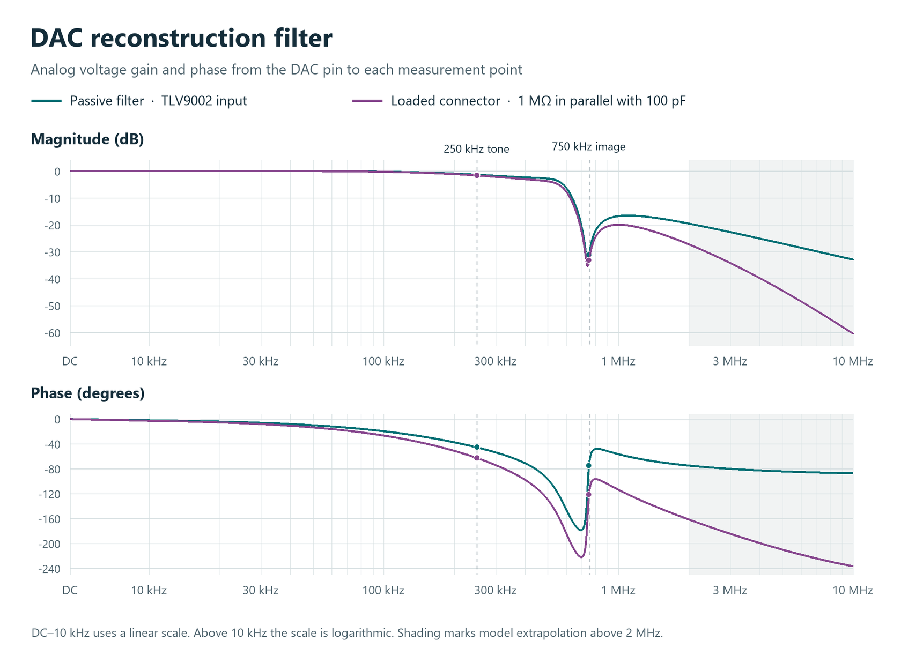
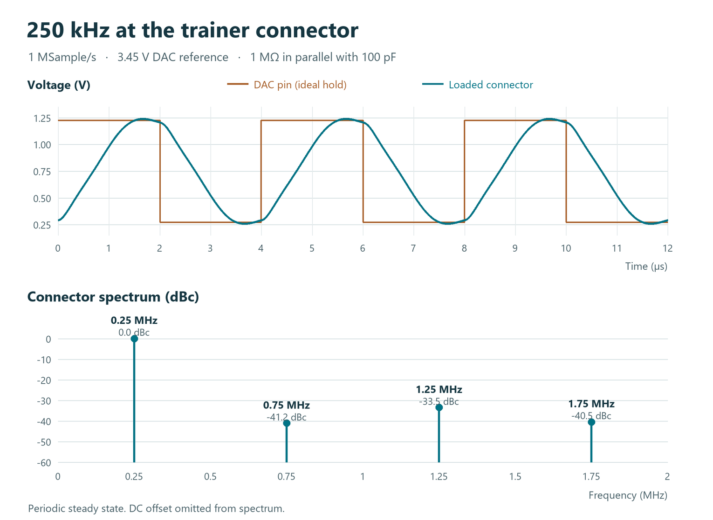
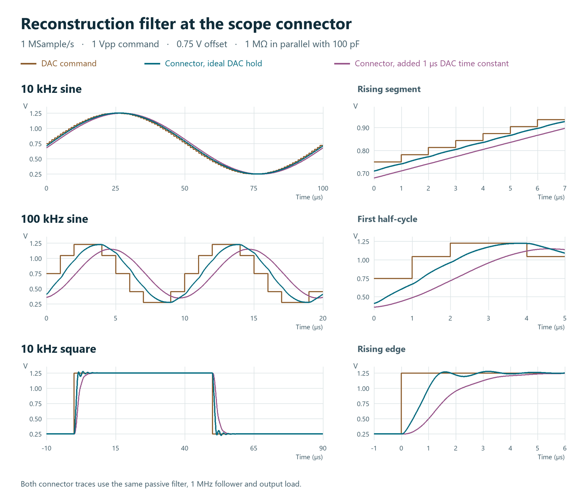

# DAC reconstruction filter simulation

Each DAC channel drives a 5.6 kΩ series resistor, a 22 pF shunt capacitor, a parallel 1 mH / 47 pF tank in the signal path, and a 68 pF shunt capacitor at the TLV9002 input. The 47 pF capacitor tunes the notch for the first sampling image. The schematic uses 0805 HandSolder resistors and C0G capacitors and 1812 HandSolder inductors.

## Bode response

| Frequency | Passive filter gain | Loaded connector gain |
| --- | ---: | ---: |
| DC | 0.00 dB | −0.003 dB |
| 250 kHz · target tone | −1.42 dB | −1.69 dB |
| 739 kHz · notch minimum | −33.42 dB | −35.43 dB |
| 750 kHz · first image | −31.26 dB | −33.31 dB |
| 1.25 MHz · next image | −16.83 dB | −21.22 dB |

The first −3 dB crossings are 516 kHz at the follower input and 390 kHz at the connector. The analog sweep uses the DAC pin as its reference. The region from 2 MHz to 10 MHz extrapolates the coil model. [Coilcraft model limits, page 2](https://www.coilcraft.com/getmedia/f7d0afe6-7e6d-4f7c-8183-7c22379d6d80/spice_1812ls.pdf#page=2)

## Calibrated 250 kHz sine

At 1 MSample/s, repeat DAC codes **1457, 1457, 324, 324**. The model uses a 3.45 V reference and 4095 counts for full scale, giving a high level of 1.2275 V and a low level of 0.2730 V. The 250 kHz fundamental is 0.9999 Vpp. The connector trace spans 0.2608–1.2392 V, or 0.9785 Vpp, centered at 0.7500 V. The residual images change the trace peaks. If calibrating to the scope’s time-domain Vpp reading, codes 1470 and 312 give 1.0000 Vpp on the trace and a 1.0220 Vpp fundamental.

| Component | Connector amplitude (Vpp) | Relative to 250 kHz |
| --- | ---: | ---: |
| 250 kHz | 0.99990 | 0.0 dBc |
| 750 kHz | 0.00875 | −41.2 dBc |
| 1.25 MHz | 0.02112 | −33.5 dBc |
| 1.75 MHz | 0.00942 | −40.5 dBc |

The simulation applies a 1 µs zero-order hold and computes the complex gain at each harmonic. It models the coil as 820 µH and 129 Ω in series, with 9.65 pF winding capacitance, and counts 75 pF total at the follower input. The follower has a single 1 MHz pole. The output model uses 10 Ω switch resistance and 330 Ω series resistance into 1 MΩ in parallel with 100 pF. These are nominal predictions. Physical DAC settling during the 0.955 V transitions, component tolerances and board parasitics require measurement. [Bench test plan](../kicad/DAC%20reconstruction%20filter%20test%20plan.md) · [Reproduce the waveform and spectrum with Python, NumPy and Pillow](simulate_250khz.py)

## Lower-frequency waveforms

